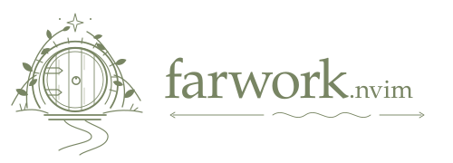

Local Neovim editing. Remote tools, builds, and workspaces.

**Edit locally. Run clangd, builds, and checks on your remote machine.**

Use your local Neovim, plugins, and file picker while the remote machine supplies
the compiler and dependencies. Save a file to upload it over SSH.

[Get started](#get-started) · [Commands](#commands) · [Git and checks](#git-and-checks) · [Fix a problem](#fix-a-problem) · [Configuration](#configuration)

```text
Your computer                       Remote machine
Neovim + local files  ── save ────►  Project files + dependencies
                      ◄── SSH ────  clangd, CMake, pre-commit
```

- Typing, movement, and file searches run locally.
- C/C++ completion, diagnostics, and navigation use remote clangd.
- Builds use the remote toolchain, including a Python venv if needed.
- Pre-commit checks run remotely and can return formatting fixes to local files.
- `:RemoteDoctor` explains sync failures and guides you through supported repairs.

> **Local files are the source of truth.** Normal sync uploads files; it does not
> merge remote edits back into local files. Uploads can overwrite matching remote
> files. Use one uploading Neovim session per remote project.

## Get started

### 1. Prepare both machines

| Your computer | Remote machine |
| --- | --- |
| Neovim 0.11+ | Bash and a Unix filesystem |
| Git, SSH, Python 3.9+, rsync 3+ | Git, Python 3.9+, rsync, clangd |
| Linux or macOS | CMake and your project's dependencies |
| | pre-commit, if you use remote checks |

The plugin does not install these tools or configure your build. It supports
C/C++ through clangd. Coder is optional; any working SSH alias can be used.

Set up an alias in `~/.ssh/config`, then test it from your local terminal:

```sh
ssh build-host true
```

Replace `build-host` with your alias. Authentication must work without an
interactive password prompt. Keep SSH users, ports, keys, and proxies in your
SSH config.

On the remote machine, configure your project with
`CMAKE_EXPORT_COMPILE_COMMANDS=ON`. Use your project's normal CMake options and
environment. The build directory must contain `compile_commands.json` before
you connect.

### 2. Install the plugin

Add this entry to your **lazy.nvim** plugin list:

```lua
{
  "louqash/farwork.nvim",
  lazy = false,
  opts = {
    auto_connect = true,
    auto_commit = true,
  },
  config = function(_, opts)
    require("farwork").setup(opts)
  end,
}
```

This example enables two optional features:

- `auto_connect`: connect when you open a known remote project.
- `auto_commit`: advance remote Git metadata after a local commit, but only
  when the history is a fast-forward and the remote files already match.
  It does **not** create commits for you.

Both options are off by default. No extra completion or file-picker plugin is
required. For local development, add `dir = vim.fn.expand("~/farwork.nvim")`
to the plugin entry.

Restart Neovim and check the local tools:

```vim
:checkhealth farwork
```

<details>
<summary>Install without lazy.nvim</summary>

Add the plugin directory to `runtimepath`, then call `setup()`:

```lua
vim.opt.runtimepath:prepend("/absolute/path/to/farwork.nvim")
require("farwork").setup({
  auto_connect = true,
  auto_commit = true,
})
```

</details>

### 3. Describe your project

Use the repository root on both machines. In the **local** project root, create
`.farwork.json`:

```json
{
  "host": "build-host",
  "remote": "/home/dev/my-app",
  "build": "/home/dev/my-app/build",
  "environment": "source /home/dev/my-app/.venv/bin/activate"
}
```

| Field | Meaning |
| --- | --- |
| `host` | Required. An SSH alias from your SSH config. |
| `remote` | Required. The absolute path to the remote repository. |
| `build` | Optional. The remote directory containing `compile_commands.json`. Otherwise, the plugin searches for it. |
| `environment` | Optional. A Bash command run remotely before discovery, clangd, builds, and checks. Omit it if no setup is needed. |

All paths in this file refer to the **remote machine**. A remote venv stays
remote; the plugin does not copy it to your computer.

If these settings are personal, add `.farwork.json` to
`.git/info/exclude`. You can also share the file with your team and use the same
SSH alias with different connection details on each computer.

### 4. Open Neovim and connect

Open a local project file. With `auto_connect` enabled, the plugin finds the
project config and connects. Neovim asks you to trust the config before using
it, and asks again if its contents change. Read it first: it sets the upload
destination and may run a remote shell command.

To connect manually, run:

```vim
:RemoteStart
```

Wait for the initial upload to finish. Check the connection with:

```vim
:RemoteStatus
```

For a C/C++ buffer, the attached server should show `remote_clangd` as initialized.
Save files as usual. Build with `:RemoteBuild`.

<details>
<summary>No project file? Use interactive setup</summary>

Run `:RemoteStart` from the local repository root. Enter
`build-host:/absolute/remote/project`, an optional environment command, and the
build directory if asked. These settings are saved locally for later sessions.
Use `:RemoteStart!` to change them, or `:RemoteProjects` to choose a saved project.

If the local directory has no `.git`, the plugin can copy the remote Git history
and download missing source files. Existing local files are preserved. Existing
Git checkouts skip that download. Start with matching branches and commits when
using two existing checkouts; use `:RemoteDoctor` if they differ.

</details>

<details>
<summary>Already running a local clangd?</summary>

Use this callback to keep local clangd out of remote projects:

```lua
vim.lsp.config("clangd", {
  root_dir = require("farwork").local_clangd_root,
})
```

Remote clangd inherits capabilities and settings from `vim.lsp.config.clangd`.
Keep your usual LSP keymaps and completion setup. This plugin does not install
bindings such as `gd` or hover.

</details>

## Commands

| Task | Command |
| --- | --- |
| Connect or reconnect | `:RemoteStart` |
| Change connection settings | `:RemoteStart!` |
| Choose a saved or configured project | `:RemoteProjects` |
| See connection, LSP, and upload status | `:RemoteStatus` |
| Upload saved files and retry the queue | `:RemoteSync` |
| Wait for uploads | `:UploadWait` |
| Inspect or retry a failed upload | `:UploadStatus` / `:UploadRetry` |
| Explain a sync failure and review a repair | `:RemoteDoctor` |
| Build remotely | `:RemoteBuild` |
| Build a target | `:RemoteBuild --target my_app -j 8` |
| Run pre-commit on staged files | `:RemoteCheck` |
| Run pre-commit on all files in the Git index | `:RemoteCheck!` |
| View the remote diff | `:RemoteDiff` / `:RemoteDiff!` for staged changes |
| Restart remote clangd | `:RemoteRefresh` |
| Stop uploads and discard the queued transfers | `:UploadStop` |

`RemoteSync` does not save buffers. `RemoteBuild` requires saved project buffers
and an idle upload queue. `UploadWait` can stop waiting because of an error;
check that uploads finished successfully, not just that the command returned.

`UploadStop` preserves local files. It stops uploads, not the whole remote LSP
connection. Close Neovim to end the session.

## Git and checks

### A normal edit and commit

1. Edit and save locally.
2. Run `:UploadWait` and confirm that uploads succeeded.
3. Stage the files you want to commit with `git add`.
4. If the project uses pre-commit, run `:RemoteCheck`.
5. Review any returned fixes, stage them, and rerun the check.
6. Wait for uploads to succeed, then commit and push locally.

A push updates your Git server. It does not update the remote working checkout.
With `auto_commit = true`, the next upload can advance the remote branch and
index when its tracked files already match your new commit. Other mismatches
pause uploads and point you to `:RemoteDoctor`.

### How remote pre-commit works

`:RemoteCheck` sends a copy of the **local Git index**—the staged version of your
files—to a temporary remote repository. It runs hooks on the staged added or
modified files using your remote environment. A split opens at once and shows
progress and hook output.

Formatting fixes return to your computer. The plugin applies them only if:

- The Git index has not changed during the check.
- Each affected local file still matches the version that was checked.
- The affected buffers have no unsaved edits.

Fixes remain **unstaged** so you can review them. If a file conflicts, the whole
batch of fixes is kept for review instead. The output shows where to find the
original files, fixed files, and logs.

> `:RemoteCheck!` checks every file in the index. It does not include unstaged
> edits or untracked files. Neither command installs a local Git hook.

Hooks run outside the main remote checkout. Hooks that need its build artifacts
may fail there. Private hook repositories need remote Git credentials. Submodules
and links outside the snapshot are not supported. File deletions require manual
review. Closing Neovim during a check does not guarantee that it finishes.

### A merge or rebase

Finish uploads, then run `:UploadStop`. Resolve conflicts locally and finish the
merge or rebase. Run `:RemoteDoctor` to review how the remote checkout should
catch up. If uploads were stopped, run `:RemoteStart` after recovery.

## Fix a problem

For a Git mismatch, start with:

```vim
:RemoteDoctor
```

It opens a report, holds uploads while you review it, and lists each affected
file:

| Label | Meaning |
| --- | --- |
| `COPY` | The remote file still has its old committed content. The repair can copy the local committed version. |
| `KEEP` | The remote file already matches the local commit. |
| `REVIEW` | The plugin cannot choose safely. Review this file yourself. |

When repair is supported, select **Repair remote from local commit, then resume
uploads**. Cancel is the default. The helper checks the plan again before
applying it; new edits invalidate the plan.

Recovery treats the **local commit** as the version to keep. It can repair
missed uploads and rebased history when remote files contain either their old
committed content or the desired local content. It preserves the old remote
commit in backup refs. It does not stash, clean, or reset your remote checkout.
The venv, build outputs, and untracked files are left alone during repair.

### When recovery stops

| Message or symptom | What to do |
| --- | --- |
| Local edits are not committed | Review and finish the local commit you want the remote to match. Run the doctor again. |
| Git operation or lock is active | Run `git status` in the checkout named in the report. Finish or deliberately abort the operation. Do not delete a lock while Git is running. |
| Remote staged changes | Review `git diff --cached` on the remote and preserve that work first. |
| Conflicting remote edits | Review the named files with `:RemoteDiff` or remote `git diff`. Copy wanted changes to a separate local file and merge them locally. Resolve any remaining remote difference explicitly. |
| Remote commits are missing locally | Run the fetch command in the report, then inspect `git log FETCH_HEAD`. Fetching does not switch your local branch. |
| Branch names differ | Choose the intended branch on each side. The doctor does not switch branches. |
| Added, deleted, renamed, linked, or protected paths | These need manual review. Guided repair only changes existing regular tracked files. |
| SSH or upload failure | Reconnect the workspace and test its SSH alias. Then use `:UploadRetry`. |
| Missing local tools | Run `:checkhealth farwork`. |
| Stale C++ diagnostics | Check `:RemoteStatus`. Once uploads are idle, try `:RemoteRefresh`. |
| Build uses the wrong Python | Activate the remote venv, then reconfigure CMake's cached Python interpreter. |

If a repair is interrupted, some verified files may already have changed. The
error reports the backup location. Run `:RemoteDoctor` again before continuing.
Do not run another uploader or remote Git operation during recovery.

See `:help farwork-recovery` for details.

## Configuration

The installation example is enough for most users. These are the full defaults:

<details>
<summary>All options</summary>

```lua
require("farwork").setup({
  auto_connect = false,
  auto_commit = false,
  keymaps = false,
  notify_uploads = false,
  projects = {},
  rsync = "rsync",
  clangd_args = { "--background-index", "--clang-tidy" },
  build_command = function(project)
    return { "cmake", "--build", project.build }
  end,
  check_command = { "pre-commit", "run", "--hook-stage", "pre-commit" },
  upload_exclude = function(relative_path) return false end,
  state_dir = nil, -- Neovim's standard state directory
  cache_dir = nil, -- Neovim's standard cache directory
})
```

- `clangd_args` replaces the default flags. The plugin supplies path mappings
  and the compilation database; do not add conflicting flags.
- `build_command` returns an argument list. It runs from the remote project
  directory; shell quoting is handled for you.
- `check_command` is an argument list. The plugin appends `--files ...` or
  `--all-files`.
- `upload_exclude` adds exclusions. It cannot remove the built-in protections
  and does not control the initial download.
- `notify_uploads` enables success messages for individual uploads. Errors are
  always shown.

With `keymaps = true`, the plugin adds:

| Key | Action |
| --- | --- |
| `<leader>rs` | Connect |
| `<leader>rb` | Build |
| `<leader>rd` | Remote diff |
| `<leader>us` | Start uploads without remote clangd |
| `<leader>ui` | Upload status |

For your own bindings, use normal `vim.keymap.set` calls.

</details>

<details>
<summary>Project profiles in Lua</summary>

Use a Lua profile instead of a project file if you prefer:

```lua
require("farwork").setup({
  auto_connect = true,
  projects = {
    ["~/src/my-app"] = {
      host = "build-host",
      remote = "/home/dev/my-app",
      build = "/home/dev/my-app/build",
      environment = "source /home/dev/my-app/.venv/bin/activate",
    },
  },
})
```

Discovery walks up from the current file, or the working directory for an empty
buffer. It stops at the nearest project file or Git root. A project file at that
Git root is included; files above it are not.

The deepest matching project-file, saved, or configured root wins. At the same
root, Lua fields override JSON fields. JSON replaces saved settings, so an
omitted environment command does not inherit an old one.

A failed or cancelled automatic connection is not retried on every buffer
switch. Use `:RemoteStart` to retry. Switching away from an active remote project
is also explicit. The plugin never executes repository-local Lua files.

</details>

<details>
<summary>Lua API</summary>

```lua
local remote = require("farwork")
remote.start({
  root = vim.fn.expand("~/src/my-app"),
  destination = "build-host:/home/dev/my-app",
  build = "/home/dev/my-app/build",
  environment = "source /home/dev/my-app/.venv/bin/activate",
})

local state = remote.status()
-- root, host, remote, build, connecting, ready, lsp_connected
-- upload: enabled, paused, busy, queued, error, message
```

`status()` returns a fresh table without notifications. `ready` means the initial
upload finished; `lsp_connected` means clangd is initialized and running.
`is_project()` checks whether the working directory is in the active project.
`owns_buffer(bufnr)` checks whether a buffer belongs to it.

</details>

<details>
<summary>Uploads without remote clangd</summary>

Run `:UploadStart` from a local project directory. Enter a destination such as
`build-host:/home/dev/my-app/`. The plugin remembers it and uploads on save.
Use `:UploadStart another-host:/absolute/path/` to change the destination.

This mode does **not** use the Git guard. It also does not supply remote language
analysis; local language servers still need local dependencies.

For save-only uploads through Lua:

```lua
require("farwork.upload").start({
  root = vim.fn.getcwd(),
  destination = "build-host:/home/dev/my-app/",
  initial_sync = false,
  exclude = require("farwork.upload").default_exclude,
})
```

</details>

## Sync behavior

| Item | Behavior |
| --- | --- |
| Saved source files | Uploaded on startup and save. Matching remote files are overwritten. |
| Unsaved buffer edits | Sent to clangd for analysis, but not uploaded as files. |
| `.git`, `.venv`, `venv`, `.env*`, `node_modules`, `__pycache__`, `.DS_Store` | Excluded from normal uploads. |
| Top-level `build/`, the selected build directory, `compile_commands.json` | Excluded from project uploads. Tracked source folders named `build` elsewhere are not excluded just for that name. |
| Deleted files and renames | Not propagated as Git operations or remote deletions. |
| Symlinks and empty directories | Not uploaded. |
| `.gitignore` rules | Not used as upload exclusions. Add `upload_exclude` rules where needed. |
| Remote-only headers | Fetched on demand and opened read-only. |
| Remote formatting fixes | Returned only through the remote-check workflow. |

You can keep editing saved local files offline. Remote LSP features and builds
need a connection. Local Git diff and status work offline. Upload queues live
in memory: closing Neovim does not preserve the queue. Reconnect and run a full
sync to send saved files that have not reached the remote.

The plugin supports one active remote project per Neovim instance. LSP requests,
remote headers, builds, and checks still have network latency. It does not copy
or recreate the remote dependencies on your computer.

## Remove a project

Finish uploads, then close the Neovim session. Remove `.farwork.json`
and any matching Lua profile or saved entry in `remote-projects.json`. This
removes the connection settings, not your local files or remote workspace.
Removing the marker alone does not stop an active connection.

## State, backups, and logs

Paths are relative to Neovim's standard directories unless you override them:

| Location | Contents |
| --- | --- |
| State: `remote-projects.json` | Connections saved by interactive setup. Project-file connections do not create entries. |
| State: `upload-projects.json` | Destinations saved by `UploadStart`. |
| Cache: `remote-headers/` | Remote headers fetched for navigation. |
| Cache: `checks/` | Check logs and returned fixes in `before/` and `after/`. |
| Cache: `recovery/` | Saved recovery plans. |
| Remote Git: `refs/nvim/backups/commit-*` | Old commits saved by automatic alignment. |
| Remote Git: `refs/nvim/backups/recovery-*/head` and `/target` | Old and target commits saved by guided recovery. |

Inspect remote backup refs with `git for-each-ref refs/nvim/backups`. Older
backup refs are retained too. Backups are not removed automatically.

## Development

Run the test suite from this repository:

```sh
make test
```

Tests need Neovim, Python, Git, Bash, clangd, and rsync 3+ on `PATH`. They use
temporary local repositories and a local substitute for SSH. They do not connect
to your workspace.

See [CONTRIBUTING.md](CONTRIBUTING.md) and the
[Neovim help file](doc/farwork.txt). Licensed under [MIT](LICENSE).
